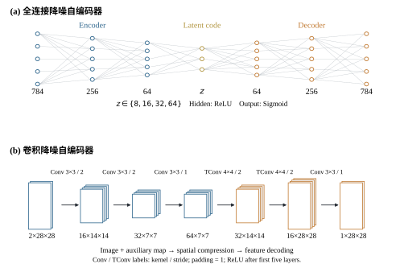
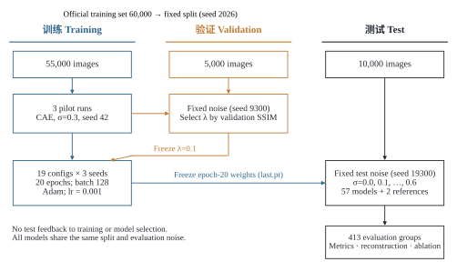

# MNIST Denoising Study

Reproducible experiments on fully connected and convolutional denoising autoencoders: bottleneck capacity, noise mismatch, known-noise conditioning, residual prediction, and gradient supervision.

本项目为 MNIST 图像降噪课程研究，包含 **19 种配置 × 3 个随机种子 = 57 次正式训练**，另有 3 次验证选参预实验；对 10,000 张独立测试图像、7 个噪声水平进行统一评价，总计 **413 组评价**。



## Main findings

| Matched noise | CAE PSNR / dB | CAE+G PSNR / dB | CAE SSIM | CAE+G SSIM |
| --- | --- | --- | --- | --- |
| σ=0.3 | 23.659 ± 0.034 | 23.717 ± 0.037 | 0.9299 ± 0.0024 | 0.9392 ± 0.0003 |
| σ=0.5 | 20.316 ± 0.027 | 20.317 ± 0.060 | 0.8674 ± 0.0023 | 0.8724 ± 0.0041 |

数值为三个训练种子的均值 ± 样本标准差。梯度约束带来结构相似度收益，但高噪声下像素误差未同步改善；残差及残差+梯度组合在当前结构与 20 轮预算下退化。混合噪声训练和已知 σ 条件输入的收益依赖测试噪声范围。完整原始精度记录见 results/。

## Reproduce

项目支持 Python 3.10；正式实验使用 Kaggle 预装 GPU 环境。先安装适配平台的 PyTorch/torchvision，再安装其余依赖。不要在已有 Kaggle GPU 环境覆盖安装 CPU 版本。

```bash
python -m pip install -r requirements-runtime.txt
python src/prepare_data.py
python src/check_pipeline.py
python src/run_experiments.py --stage all --seeds 42 2026 3407 --device cuda --list
python src/run_experiments.py --stage all --seeds 42 2026 3407 --device cuda
python src/evaluate.py --split test --device cuda
python src/summarize.py --split test --device cpu
```

完整流程、下载代理处理、断点恢复、环境版本和统计定义见 [复现说明](docs/REPRODUCIBILITY.md)。CPU 仅需快速检查时，可运行 `python src/train.py --config configs/fc_smoke.yaml`，其结果不纳入论文。

## Protocol



- 官方训练集固定划分为 55,000/5,000，测试集独立保留 10,000 张。
- 归一化到 [0,1]，输入为 clip(x+σε,0,1)。训练动态噪声，验证和测试按图像 ID 固定噪声。
- 全部正式配置使用 20 epochs、batch 128、Adam lr=0.001；最终使用 epoch-20 last.pt。
- λ 和高斯滤波宽度仅由验证集选择；测试结果不参与选型。
- 相同图像、噪声和训练种子配对消融。标准差刻画训练随机性，不作为显著性证据。

## Repository

```text
src/          Data, corruption, models, losses, training, evaluation and plots
configs/      Frozen experiment plan and single-run configurations
tests/        Synthetic-data checks for the training/evaluation workflow
docs/         Reproduction guide and recorded environment
results/      Aggregate metrics, seed-level records and editable table CSVs
figures/      Scientific diagrams and result charts in editable SVG
```

数据由准备脚本从公开镜像下载。本仓库不包含 MNIST 原始文件、模型权重、逐图全量结果包、教师模板或个人封面。论文最终图表所用完整实验归档保留本地；轻量汇总数据可直接核对主要数值。制图脚本中涉及完整归档的步骤需先恢复该归档，具体前提见复现说明。

## Scope

实验结论限于 28×28 灰度数字及截断高斯合成噪声。已知 σ 模型的额外信息应与普通模型区别解释。未训练 DnCNN、SwinIR、Restormer 或其他自然图像基准模型，不宣称通用最优性能。
